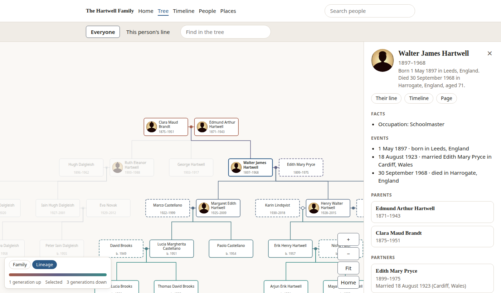
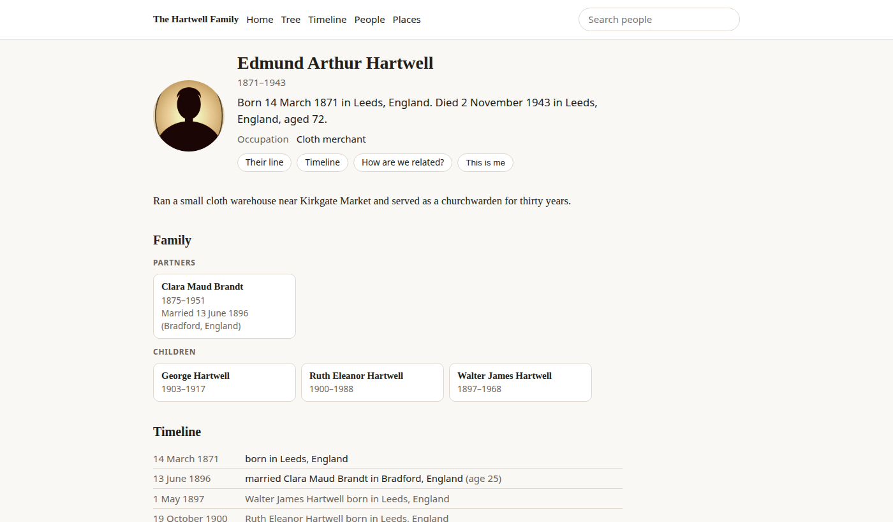
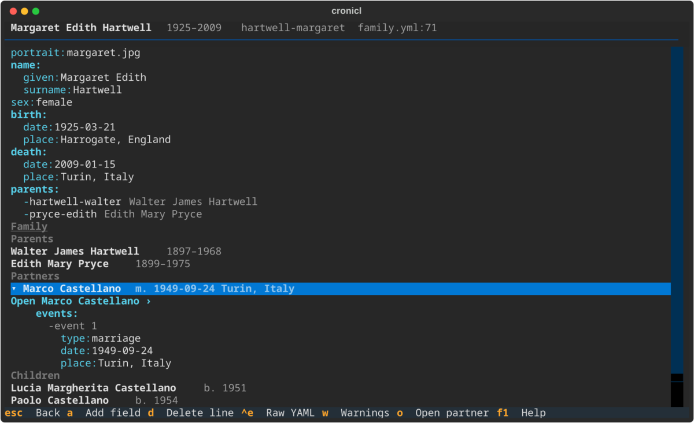

<p align="center">
  <picture>
    <source media="(prefers-color-scheme: dark)" srcset="https://raw.githubusercontent.com/cbenning/cronicl/main/assets/cronicl-wordmark-dark.svg">
    
  </picture>
</p>

<p align="center">
  <a href="https://github.com/cbenning/cronicl/actions/workflows/ci.yml"></a>
  <a href="https://github.com/cbenning/cronicl/blob/main/LICENSE"></a>
  
</p>

<p align="center"><b>Your family tree, kept as plain text you own.</b><br>
Edit it in a friendly terminal app, check it for mistakes, trade GEDCOM, and publish it as a website.</p>

- 📝 **Plain text.** One YAML file you can edit by hand, diff and keep in git.
- 📖 **A documented format.** A spec, JSON Schema and test suite, so other tools can read it too.
- ✅ **Validation.** `cronicl check` finds broken links, loops and impossible dates, with file and line.
- ⌨️ **A terminal editor.** Find, edit and fix people in a [TUI](#the-tui) that shows a diff before it writes.
- 🔧 **Command-line tools.** Search, show, add, rename and spot gaps from scripts.
- 🔄 **GEDCOM in and out.** Import once, export whenever you like.
- 🌳 **A static website.** Pan-and-zoom tree, timeline, person pages, places and kinship. Host it anywhere.
- 🔒 **Privacy controls.** Show, mask or hide living people before you publish.

## Screenshots

<h3 align="center">The website</h3>

<p align="center">
  
  
</p>
<p align="center"><sub>The pan-and-zoom tree with a person selected, and that person's own page.</sub></p>

<h3 align="center">The terminal editor</h3>

<p align="center">
  
</p>
<p align="center"><sub>One person's record in <code>cronicl</code>, with a partner's marriage details expanded. Both screenshots use a made-up family.</sub></p>

Status: 1.0. The file format is specified in [`SPEC.md`](https://github.com/cbenning/cronicl/blob/main/SPEC.md); a JSON
Schema (`cronicl schema`) and a conformance suite (`tests/conformance/`) travel with it, so another tool can read
and write the same file.

## Install

```bash
uv tool install cronicl      # or: pipx install cronicl, or pip install cronicl
```

Python 3.10 or newer. To work on cronicl itself, clone the repository and run `uv sync`, then put `uv run` in front
of the commands below.

## Quick start

```bash
mkdir ~/my-family && cd ~/my-family
cronicl init                       # creates site.yml, family.yml, media/, archive/
cronicl import-gedcom tree.ged     # preview: counts and warnings
cronicl import-gedcom tree.ged -a  # write family.yml
cronicl                            # the TUI: find, edit, add people, fix warnings
cronicl check
cronicl search ashby               # find ids
cronicl show ashby-greta           # one person, with the line each record lives on
cronicl serve                      # http://127.0.0.1:8000/
```

Commands work on the folder you are in. To run them from somewhere else, pass `--dir DIR` (or `-C DIR`), or set
`CRONICL_DIR`.

## The TUI

Run `cronicl` with no command in a terminal (in a folder with a `family.yml`, or with `-C DIR`) and a full-screen
editor opens. It is a faster way to change `family.yml`, not a replacement for it: the file stays plain YAML you can
edit by hand, and the TUI changes only the lines it has to.

- **Find people** by typing: names, years and places, with typos and accents forgiven. Enter opens a person.
  Warnings are marked in the list.
- **Edit a person** as their record: one field per line, and Enter on a line opens an editor that fits it. Text is
  plain, dates read back to you as you type (and F2 to F7 insert *about*, *before*, *after*, *between*, *from-to* and
  *unknown*), `sex` and event types are lists, parents and partners are picked by name from a list that never offers
  someone who would make a loop. Long text and raw YAML open a text box (Ctrl+S saves).
- **Add things** with `a`: a searchable list of the fields this record does not have yet, each event type, a partner
  (with the marriage date and place) and a child. Choosing "New person…" in any picker creates one.
- **Delete** a line with `d`. Ctrl+E edits the person's whole record as YAML.
- **Fix warnings**: `F2` (or `w` on a person) lists everything `cronicl check` reports; Enter jumps to the line, `f`
  proposes the fix. A `death: no` is never turned into a death without asking: the default answer is "they are alive".
- **Nothing is written until you confirm.** Leaving a person, quitting, or applying a fix shows a diff of exactly
  which lines change in which file. Enter writes, `n` keeps editing, `x` discards everything. If a file changed on
  disk while the TUI was open, nothing is written. Comments, blank lines and the order of your records stay as they
  were; a record written as a one-line `{...}` is rewritten in block style only when an edit needs more room, and
  the diff shows it. Writes are atomic, and CRLF line endings and a byte-order mark are kept.
- `F1` or `?` shows the keys. A family with more than one file in `family/` asks which file a new person goes in.

Without a terminal (a pipe, a script) a bare `cronicl` still prints the usage error, and every other command works
as before.

## Commands

Every command that works on a cronicl folder takes `--dir DIR` (`-C DIR`), before or after the subcommand.
If it is omitted, `$CRONICL_DIR` is used, and failing that the current directory. Every command that writes
files previews by default and needs `--apply` (`-a`). Writers change only the lines they must: comments, blank
lines and the order of records stay as you left them.

| Command | What it does |
|---|---|
| `init` | Create `site.yml` (with a random `id_salt`), `family.yml` with a short example, `family.schema.json`, `media/`, `archive/`. |
| `check [--format json] [--strict]` | Report problems, with file and line. Exit 1 on errors (and on warnings with `--strict`). Also named `validate`. |
| `show ID` | Print one person as the site sees them: record, parents, partners, children, siblings and where each record lives. |
| `search WORD... [--limit N] [--format json]` | Fuzzy-find people and print their ids (name, id, years, places; typo- and accent-tolerant). `*` marks people the privacy rules treat as living. Exit 1 when nothing matches. |
| `gaps [--limit N] [--format json]` | List people with missing names, dates, places or parents, best-connected first. |
| `new --given G --surname S [...] [-a]` | Append one person record to `family.yml` (`--file` picks the file in a `family/` folder), with optional dates, places, parents (`--parents`), and `--partner ID` for an empty couple record. |
| `rename OLD NEW [-a]` | Change a person's id everywhere it is used: the record key, `parents` lists, couple keys and `home` in `site.yml`. |
| `edit mark-deceased ID... [-a]` | Write `death: unknown` for the named people (no date needed). All ids are validated first. |
| `edit mark-living ID... [-a]` | Write `living: true` for the named people. |
| `import-gedcom FILE [-a]` | One-time GEDCOM import into `family.yml`; archives the original file. |
| `export-gedcom [--out FILE] [--include-living] [--no-extra] [--ignore-errors]` | Write the family as a GEDCOM 5.5.1 file ([details](#gedcom-export)). Never changes your data; like `build`, it stops (exit 1) if `check` finds errors, unless `--ignore-errors`. |
| `build [--out OUT] [--ignore-errors]` | Run `check`, then generate the static site (default `OUT` is `<dir>/out`). |
| `serve [--out OUT] [--port N] [--ignore-errors]` | Build and serve locally. |
| `schema` | Print the JSON Schema for `family.yml` (for editors and agents). Needs no folder. |

`edit` holds the commands that change a person's record by hand-picked id, so it stays separate from the
read-only utilities. There is deliberately no bulk form.

## Views

`serve` / `build` produce a static site:

- `index.html` is the **home page**: a heading and optional `intro:` text (Markdown, from `site.yml`), a
  search box, a "Start with" card when `home:` is set, the numbers (people, generations, years), the commonest surnames, an
  and an "On this day" list (filled in by the browser).
- `people/index.html` lists everyone grouped by surname; any page's search box filters it (`?q=`).
- **Kinship:** each person page and side panel says how that person is related to you ("Your
  great-grandmother"). Press **This is me** on your own page and the choice is remembered in your browser only
  (`localStorage`, never sent anywhere); until then no relationship line is shown, because nobody is the reference.
  `relate/index.html` answers "how are these two people related?" for any pair (`?a=<id>&b=<id>`). Kinship is
  worked out in the browser from `kin.json`; pages without JavaScript simply omit the line.
- `sources/index.html` lists every source cited and who cites it (see [Citations](#citations)); it and its top-bar link exist only when something is cited.
- `map/index.html` is the [map](#map), present only when you configure one.
- `places/index.html` lists every place named in the files and who was born, died or married there, grouped by
  the last part of the name ("Hamburg, Germany" is under Germany). Nothing is guessed: a region such as
  "Ontario" is its own group unless `site.yml` folds it in (`place_groups: {Ontario: Canada, Holland: Netherlands}`,
  matched ignoring case). A name with no comma that is not a group's own name goes under "Other places".
- `tree/` is the family tree and `timeline/` is the timeline: two pages of one viewer, described next. Every
  address means one thing:

  | Address | Shows |
  |---|---|
  | `tree/` | everyone, fitted to the screen |
  | `tree/#<id>` | the same tree with that person selected |
  | `tree/#focus/<id>` | only that person's line: ancestors and descendants |
  | `timeline/` | the timeline |
  | `timeline/#<id>` | the timeline with that person selected |

  The top bar is the same on every page (Home, Tree, Timeline, People, Places, and a people search). Old
  `tree.html#/...` and `index.html#/...` links are forwarded to these addresses.

The viewer has two modes on the tree page, **Everyone** and **This person's line**, and a find box:

- **Tree:** every person on a pan-and-zoom canvas (only what is on screen is drawn). Long names wrap onto two
  lines; siblings and half-siblings always share a row.
- **Reading the tree:** at rest every connector and box outline is one quiet, light colour, and hovering a
  person only accents that one box. Selecting a person shades their own line by generation: oldest ancestors
  deep red, the selected generation violet, the youngest descendants green, with partners dashed and everyone
  off the line faded. Each side of the ramp is stretched over its own depth, and hovering a node says how many
  generations it is above or below. A **Family** toggle in the legend (remembered in the browser) switches to
  relationship colours instead: parents orange, partners pink, children green, siblings (including
  half-siblings) violet.
- **Islands:** families that are not connected to each other are laid out as separate blocks, largest first, left
  to right, so a small unrelated family can no longer sit in the middle of the main tree and bend its lines.
  People with no recorded relatives go in a labelled "Not connected to anyone" grid below everything else.
- **Timeline:** one lifespan bar per person on a zoomable time axis that never runs past next year. A living
  person's bar runs to today; a bar with no recorded death fades out after eight years rather than guessing an
  end. Partnerships are small marks on both partners' bars. `timeline/#<id>` selects that person, scrolls to
  their row and dims everyone who is not a parent, partner, child or sibling. People with no dated events are
  listed underneath.
- **Focused tree:** `tree/#focus/<id>`, or "Their line" in the side panel: that person, everyone above them,
  everyone below them, and the spouses of those people. Siblings, aunts and uncles are hidden until you pick
  "Show full tree". The layouts are generated by `build` (`focus/<id>.json`), so there is nothing extra to run.
- **Person page:** `p/<id>/` is a static, printable page per person, written as a short biography: name, year
  label ("1941–2021", or "b. 1907" when only a birth is known), a sentence of life facts ("Born 12 March 1941
  in Guelph. Died 2021, aged 80."), the biography as prose, one Family block (parents, partners, children,
  and siblings as a compact row), one dated timeline with ages (relatives' events muted), and collapsible
  Ancestors (four generations) and Descendants lists. Empty parts are left out. The side panel shows the same
  life sentence and relatives. Warm neutral colours, serif names and headings, and automatic dark mode are used
  throughout; no web fonts are loaded.
- **Ended partnerships:** a couple that has an ending event (divorce, annulment, separation or `end`) is drawn with dashed spouse lines and a
  hollow dot; the side panel shows "Married 1975 – divorced 1990".
- **Tree, Overview and zoom:** opening the viewer with no address shows the **Everyone** (`tree/`): everyone, fitted
  to the screen. If you pressed "This is me" on a person page, it opens your own focused tree instead. The
  **Tree** tab shows a focused tree on the selected person (or the person you said is you). A focused tree opens at a
  readable size, and picking a person
  while zoomed far out zooms in on them. Zoom with the buttons at bottom right (**+**, **−**, **Fit**,
  **Home**), the keys `+`, `-` and `0`, the mouse wheel, or a two-finger pinch. Zoomed far out, names give way
  to one label per family ("Smith family · 12"). In a focused tree, a person with relatives that are not drawn
  shows **+N**; double-click a person to focus on them.

Clicking a person opens the side panel; close it with **×**, **Esc**, or by clicking empty canvas (this also
deselects).

## Data layout

```
site.yml            title, intro, home, schema_version: 3, privacy settings
family.yml          every person and couple (or a family/ folder of .yml files in the same format)
media/              portrait images named by `portrait:` in a record
archive/            original .ged files, unmodified; material set aside by import
```

When one file becomes unwieldy, make a folder `family/` of any number of `.yml` files instead (one per branch,
say). It is one or the other: having both `family.yml` and `family/` is an error. All files are read as one
stream, and an id must be unique across them.

`home:` in `site.yml` is optional. It names one person (an id) the owner wants visitors to start with: it adds a
"Start with" card on the home page and a Home button in the tree. Without it nobody is picked, so no person is
selected or treated as the reference. `check` warns when `home:` names nobody.

`portrait: scans/nora.jpg` names one picture for a person, as a path under `media/` (`.jpg`, `.jpeg`, `.png`,
`.webp`, `.gif`, `.avif`). `build` copies each referenced file, unchanged, to `out/media/`; nothing is resized,
so keep portraits at most 600px wide and under 1 MB (`check` warns above 1 MB). The picture shows on the person
page, in the side panel and on the person's tree box. A path that leaves `media/` is an error and is never
copied, and a person hidden or replaced by privacy redaction never has a portrait.

## The family file

`family.yml` is plain YAML: a mapping in which every top-level key is a record. A key that is an id
(`lovelace-ada`) is a **person**. A key of two ids joined by a plus sign (`byron-george + milbanke-annabella`,
either order) is a **couple**.

```yaml
byron-george:
  name: {given: George, surname: Byron}
  birth: {date: 1788-01-22, place: "London, England"}
  death: {date: 1824-04-19, place: "Missolonghi, Greece"}

milbanke-annabella:
  name: {given: Annabella, surname: Milbanke}
  birth: 1792-05-17

byron-george + milbanke-annabella:
  events:
    - {type: marriage, date: 1815-01-02, place: "Seaham, England"}
    - {type: separation, date: 1816}

lovelace-ada:
  name: {given: Augusta Ada, surname: Lovelace}
  sex: female
  birth:
    date: 1815-12-10
    place: London, England
    cite: Parish register, St George Hanover Square
  death: {date: 1852-11-27, place: "London, England"}
  parents: [byron-george, milbanke-annabella]
  events:
    - {type: occupation, value: Mathematician}
    - {type: residence, date: FROM 1835 TO 1852, place: "Ockham Park, Surrey"}
  refs: {gedcom: "@I123@", gallery: ada-lovelace}
  x-nickname: Enchantress of Number
  bio: |
    Mathematician and writer, known for her notes on Babbage's Analytical Engine.

    She is often described as the first computer programmer.
```

The order of records, blank lines and `#` comments are yours and carry no meaning.

The rules that keep it simple:

1. **One fact, one place.** A fact about one person is in that person's record, a fact about two people as a
   couple is in the couple's record. Nothing is stored twice, so nothing can disagree.
2. **Links point up.** `parents:` lives on the child. Children, siblings, partners and descendants are never
   written; the build derives them.
3. **Once-only things are fields, repeatable things are a list.** `birth` and `death` are fields; everything else,
   including marriage, is an entry in `events:`. Married, divorced and married again is three events.
4. **The id is the key.** No `id:` field, no filename to keep in step. Ids are lower-case letters, digits and
   single hyphens, surname first by convention (`lovelace-ada`).

### A person record

| Key | Shape | Notes |
|---|---|---|
| `name` | mapping | `given`, `surname`; optional `prefix`, `suffix`, `nickname`, `also` (a list of other names, such as a married name; searchable and shown on the page) |
| `sex` | `male`, `female`, `unknown`, `other` (any case) | absent means unknown |
| `birth`, `death` | dated fact | a person with a `death` that has a date, `unknown` or a place is deceased; `death: unknown` means dead, date not known. A `death` that is not a date (`no`, `~`) or has only a note does not count (it is reported) |
| `parents` | list of at most two ids | birth parents |
| `events` | list of mappings | `type` plus the dated-fact keys and `value` (for attributes such as an occupation) |
| `portrait` | text | a file under `media/` |
| `living` | `true` | only to say someone is alive when the dates suggest otherwise; to say someone is dead, use `death` |
| `refs` | mapping | ids elsewhere: `gedcom` (the id in an imported file), `gallery` (the person's id in the photo gallery) |
| `bio` | text | the biography, as markdown; use a `|` block for paragraphs |
| `x-...` | anything | your own keys, kept and never reported |

Only the key is required; a person with no name is reported, unless they are someone's partner or parent (a nameless record is how you write an unknown partner). `birth: 1820` is short for `birth: {date: 1820}`.

### A couple record

`events` (what happened to the couple: `marriage`, `divorce`, `engagement`, `civil-union`, `partnership`,
`separation`, `annulment`, `end`, ...), `note` and `x-...` keys. A couple record is needed only when there is
something to say: two people who share a child are shown as that child's parents without one, and an empty record
(`a + b: {}`) just says they were a couple. A couple has ended when it has an ending event (`divorce`,
`annulment`, `separation`, `end`) that no beginning event follows. A partner's death never ends a couple.

### Dates

One `date` value everywhere; there are no start and end keys.

| Written | Meaning |
|---|---|
| `1850`, `1850-03`, `1850-03-15` | a year, a month, a day |
| `ABT 1850` (also `CAL`, `EST`) | about |
| `BEF 1920`, `AFT 1880` | before, after |
| `BET 1880 AND 1890` | some time between |
| `FROM 1900 TO 1950`, `FROM 1900`, `TO 1950` | a span, for things that last (a residence, an occupation) |
| `unknown` | happened, date not known |

Keywords are GEDCOM's, in any case. For sorting and the timeline a qualified date counts as its first year; pages
show it in words ("about 1850", "1900 to 1950"). Spans on a birth, death, marriage or divorce are reported.

### Events, notes and sources

`events:` is a list of things that happened to a person or are true of them. `type` is any slug you like (hyphens
read as spaces); each entry may have `date`, `place`, `value` (for attributes such as an occupation), `note` and
`cite` (one source, or a list). `birth` and `death` may carry `note` and `cite` too. Entries with a date appear on
the person's page, in the side panel and as ticks on their bar in the timeline; entries without a date are listed
as facts. Known types read as words (`burial` is "buried", `immigration` "immigrated", `residence` "lived",
`occupation` with a value "worked as Teacher"); others are shown as written. People treated as living under
redaction never have events, notes or sources published. `import-gedcom` maps individual events and attributes
(BAPM, CHR, CONF, BURI, CREM, IMMI, EMIG, NATU, RESI, OCCU, EDUC, RELI, NATI, GRAD, RETI, CENS, WILL, PROB) to
`events:`; a family's MARR, DIV, ENGA and ANUL become events in the couple's record; whatever it cannot map goes to
`archive/gedcom-extra.yml`, which nothing reads. Search also finds event places and values.

### Citations

`cite:` on `birth`, `death` and any event holds the source of that fact: one text, or a list. A person page shows a
small superscript number after each cited fact and a numbered **Sources** list at the foot of the page (the same
text is the same number; each source links back to where it is first cited). `sources/index.html` lists every
distinct source text with the people who cite it, and the top bar links to it when there is at least one. Source
text is plain text, never HTML. People hidden or replaced by privacy redaction never show their sources, on their
page or on the Sources page. Citations on a couple's events (marriage, divorce) are kept in the file and exported to
GEDCOM but are not shown on the site yet.

`import-gedcom` turns a `SOUR` line under a birth, death, event or marriage into `cite` (a pointer is replaced by
the source record's title, abbreviation or text), and a `NOTE` there into `note`. `export-gedcom` writes each
distinct source text once as a `SOUR` record and points the facts at it.

### Writing YAML safely

Every value is read as text exactly as typed: `NO` is `NO`, `1066` is `1066`. Two traps, and `check` catches the first:

- Inside `{...}` or `[...]` a comma separates entries, so text containing a comma must be quoted:
  `place: "London, England"`. On a line of its own (`place: London, England`) no quotes are needed.
- Text containing `: ` (colon, space) or starting with `#`, `*`, `&`, `!`, `[` or `{` needs quotes. Merge keys
  (`<<`) are not supported.

An editor with YAML support underlines unknown keys and bad values as you type: `init` writes
`family.schema.json` and the first line of `family.yml` points at it.

## Validation

`cronicl check` (also `cronicl validate`) reads everything you edit and reports what it cannot use, with the file,
the **line**, the key and what to do (`family.yml:214`). It never changes a file. `--format json` gives
machine-readable output and `--strict` makes warnings fail too.

`cronicl build` and `cronicl serve` print errors in full (an error stops the build) but only one line for
warnings, such as `3 warnings: 2 W-UNKNOWN-KEY, 1 W-LIVING-FALSE (run cronicl check for details)`. Run `check` for
the list.

Errors about the family file:

| Code | Meaning |
|---|---|
| `E-BAD-FAMILY` | `family.yml` cannot be parsed, is not a mapping, uses a merge key, or both `family.yml` and `family/` exist |
| `E-NO-FAMILY` | there is no `family.yml` or `family/`; the message says to run `cronicl init` |
| `E-RECORD-KEY` | a top-level key is neither a person id nor a couple key |
| `E-RECORD-SHAPE` | a record is not a mapping; `name` is not a mapping; `parents` or `events` has the wrong shape; a list or mapping where text belongs |
| `E-DUPLICATE-ID` | the same person, or the same couple in either order, twice (also across split files); the later record in one file wins, across files the first |
| `E-COUPLE-SELF` | a couple key names one person twice |
| `E-DANGLING-REF` | a parent, or half of a couple key, is not a person in the family |
| `E-CYCLE`, `E-GENERATION-CONFLICT` | a person is their own ancestor; a person marrying their own ancestor or descendant, which the layout cannot draw |

Warnings, and the rest:

| Code | Meaning |
|---|---|
| `W-UNKNOWN-KEY` | a key that nothing reads, at any level of a record or `site.yml`, with a "did you mean" when it looks like a misspelling (`birht` for `birth`) |
| `W-FLOW-COMMA` | an empty key inside `{...}`: probably an unquoted comma (`place: London, England`) |
| `W-BLANK` | a known key with no value |
| `W-DUPLICATE-KEY` | the same key twice in one block; the later value wins |
| `W-DATE-UNPARSED`, `W-DATE-SPAN`, `W-END-BEFORE-START` | a date that is not one of the forms above; a span where one date is meant; an end before its start |
| `W-BAD-SEX` | `sex` is not `male`, `female`, `unknown` or `other` |
| `W-LIVING-FALSE` | `living:` is not `true`; it is ignored (dates decide), so say `death: unknown` for someone who has died |
| `W-EVENT-IS-FIELD`, `W-EVENT-ONCE`, `W-EVENT-PLACEMENT` | a birth or death in `events` (use the field); two burials or cremations; a marriage or divorce in a person's events (put it in the couple's record) |
| `W-NO-NAME`, `W-TOO-MANY-PARENTS`, `W-DUPLICATE-PARENT` | a person with no name who is not a partner or parent either; more than two parents; the same parent twice |
| `E-INVALID-ID` | a person id over 64 characters |
| `W-EVENT-NO-TYPE`, `W-IGNORED-FILE` | an event with no `type`; a `.yaml` file or folder inside `family/`, which is not read |
| `W-DEATH-EMPTY`, `W-COUPLE-EVENT-TYPE` | a `death` with no date or place (it does not count); a couple event type that looks like a misspelling of `marriage`, `divorce`, ... |
| `W-LIVING-AND-DEATH` | `living: true` and a `death` together; the person counts as living |
| `W-BIRTH-AFTER-DEATH`, `W-CHILD-BEFORE-PARENT`, `W-CHILD-AFTER-PARENT-DEATH` | plain years that contradict each other |
| `E-PRIVACY-MODE` | `privacy` is not a mapping, or `privacy.living` is not `full`, `placeholder` or `hidden` |
| `E-PRIVACY-SALT` | `privacy.id_salt` is a list or mapping |
| `W-PRIVACY-NO-SALT` | redaction is on but there is no `id_salt`, so the anonymised ids can be guessed |
| `W-PRIVACY-CUTOFF` | `privacy.cutoff_years` is not a whole number of at least 1; 100 is used |
| `W-SITE-VALUE`, `W-PLACE-GROUPS` | a `site.yml` value of the wrong kind; it is ignored |
| `W-NOINDEX-FILE` | (printed by `build`) a `robots.txt` or `_headers` in the output folder is yours, so noindex could not write its own |
| `E-MAP-TYPE`, `E-MAP-TILES`, `W-MAP-KEY`, `W-MAP-NO-COORDS` | a `map:` block that is missing its `type`, has a bad tile template, has a key nothing reads, or has nothing to show |
| `W-PLACE-COORDS`, `W-PLACE-UNKNOWN` | a `places:` entry that is not `[latitude, longitude]` in range; coordinates for a place no record uses |
| `E-VALIDATOR` | a check failed unexpectedly; the message names the file or step |

**Your own keys.** A key that starts with `x-` or `x_` (any case), such as `x-nickname: Annie`, is yours: it is
kept and never reported. It works at every level. (Inside `gallery:` it only silences the unknown-key warning:
everything there is published to visitors.)

**Values stay text.** `site.yml` is read the way `family.yml` is: `NO` is `NO`, `1066` is `1066`, and nothing is
turned into a boolean or a date behind your back. Where a yes/no is expected, write `true`, `yes`, `on`, `1` or
`false`, `no`, `off`, `0` in any case. Where a number is expected, write plain digits.

**Fails closed.** If `site.yml` cannot be read, or `privacy` is broken, a build that you force to continue with
`--ignore-errors` treats living people as `placeholder`, never as public. Fix the error and the real setting applies.
One side effect: anonymised ids come from the exact `id_salt` text. A salt that YAML used to read as a number
(one starting with `0` and made only of digits) now reads as typed, so those ids change once.

## Adding people

The loop that works best once the first import is done:

1. `cronicl gaps` lists who is missing a name, a date, a place or parents, best-connected people first.
2. `cronicl search WORD` finds the ids you need for parents and partners.
3. Add a record to `family.yml` by hand, or `cronicl new --given Bob --surname Smith --birth 1950-03-12 --parents smith-john brown-mary`
   to preview one; add `-a` to write it at the end of the file.
4. `cronicl check` reports anything that does not hold together.
5. `cronicl serve` shows the result.

Relatives need no bookkeeping on the other side: a child names its `parents`, and the parents' pages, the tree and
the descendants lists follow. A marriage is an event in the couple's record (`a + b:`). `cronicl rename OLD NEW`
changes an id everywhere it is used.

## Publishing

Before you publish a site that contains living people, set `privacy.living` to `placeholder` or `hidden` in
`site.yml`. While it is `full`, `build` prints `W-PRIVACY-OFF` with the number of people the privacy rules treat
as living: that is a reminder that they are all published.

`cronicl build --out public` writes a folder of plain files that any static host can serve (see
[Deploying](#deploying) and [Password protection](#password-protection)). Unless you configure a
[photo gallery](#photo-gallery) or a [map](#map), the site makes no external requests: no web fonts, scripts or analytics are loaded
from anywhere.

`site.yml` keys that shape the published site:

```yaml
title: Hollings family
intro: |                       # Markdown, shown on the home page
  Our family, from Silesia to British Columbia.
home: hollings-nora-doreen     # optional: a person to start with (an id)
edit_url: https://github.com/example/family/blob/main/{file}#L{line}   # adds "Edit this page"
contact: mailto:family@example.org    # adds "Suggest a correction" (a mailto: or https:// link)
noindex: true                 # ask search engines not to index the site (see Keeping search engines out)
place_groups:                  # optional: fold a region into its country on the places page
  Ontario: Canada
  British Columbia: Canada
privacy:
  living: placeholder
  cutoff_years: 100
```

`edit_url` must be an `https://` address containing `{id}`, `{line}` or both (`{file}` is the file holding the person's record, such as `family.yml`, and `{line}` its first line); `contact` must be `mailto:`, `http://` or `https://`.
`check` warns about anything else. People hidden or replaced by privacy redaction get neither link.

## Deploying

`cronicl build --out public` writes a folder of plain files: HTML, JSON, JavaScript, CSS and your portraits. Any
static host can serve it, and nothing runs on the server. `cronicl serve` is only for looking at the site while
you edit it; do not use it to publish. Before publishing, set `privacy.living` to `placeholder` or `hidden` in
`site.yml` (see [Publishing](#publishing)).

Every page uses relative addresses, so the site works at the root of a domain or in a subfolder
(`example.com/family/`). Each build clears only the files it generates, so `rsync --delete` of the output
folder is safe. A build reads only the data folder, not its git history, so a shallow clone works.

### GitHub Pages

Keep your data folder (`family.yml`, `media/`, `site.yml`) in a GitHub repository. In the repository's *Settings,
Pages*, set *Source* to *GitHub Actions*, then add `.github/workflows/site.yml`:

```yaml
name: Publish site
on:
  push:
    branches: [main]
  workflow_dispatch:
permissions:
  contents: read
  pages: write
  id-token: write
concurrency:
  group: pages
  cancel-in-progress: true
jobs:
  build:
    runs-on: ubuntu-latest
    steps:
      - uses: actions/checkout@v4
      - uses: actions/setup-python@v5
        with:
          python-version: "3.12"
      - run: pip install cronicl
      - run: cronicl build --out public
      - uses: actions/upload-pages-artifact@v4
        with:
          path: public
  deploy:
    needs: build
    runs-on: ubuntu-latest
    environment:
      name: github-pages
      url: ${{ steps.deployment.outputs.page_url }}
    steps:
      - id: deployment
        uses: actions/deploy-pages@v4
```

Every push to `main` rebuilds and publishes the site. With `edit_url` pointing at the repository (see
[Publishing](#publishing)), a relative can use "Edit this page" on GitHub, and the change goes live by itself.
The action versions above were current when this was written; use the current major versions.

**A GitHub Pages site is public, even when its repository is private.** Only organisations on GitHub Enterprise
Cloud can restrict a Pages site to people with access to the repository. Plan accordingly: redact living people,
and see [Password protection](#password-protection) for gated alternatives.

### Your own server

```sh
cronicl build --out out
rsync -a --delete out/ you@yourhost:/var/www/family/
```

Point any web server at that folder. The files are static; there is nothing to configure beyond HTTPS.

### Netlify, Cloudflare Pages, Vercel and similar

Connect the repository, set the build command to `pip install cronicl && cronicl build --out public` and the
publish directory to `public`.

## Password protection

A static site has no logins of its own, so a password has to come from the host or from a service in front of it.
Whatever you choose, keep living people redacted (`privacy.living: placeholder`): a password controls who gets
in, not what they pass on.

| If you have | Use | Notes |
|---|---|---|
| Your own web server | HTTP Basic auth | Simplest and sturdiest; nothing is served before the password is accepted |
| A static host and want real per-person access | Cloudflare Pages plus Cloudflare Access | No shared password; relatives sign in with an emailed code |
| GitHub Pages | See below | Pages cannot require a login on its own |

### Basic auth on your own server

Serve the site over HTTPS only (Basic auth sends the password with every request, so over plain HTTP it is
readable by anyone on the network). Create the password file outside the web root, never in git, with bcrypt:

```sh
htpasswd -B -c /etc/nginx/family.htpasswd family
```

nginx:

```nginx
location / {
    auth_basic "Family";
    auth_basic_user_file /etc/nginx/family.htpasswd;
    add_header X-Robots-Tag "noindex, nofollow" always;
}
```

Apache (`.htaccess`, with `mod_headers`):

```apache
AuthType Basic
AuthName "Family"
AuthUserFile /home/you/.htpasswd-family
Require valid-user
Header set X-Robots-Tag "noindex, nofollow"
```

Use a long passphrase and share it with the family. Consider rate limiting failed logins (fail2ban or your
host's equivalent). The login dialog is the browser's own and there is no logout; for a family site that is
usually acceptable.

### Cloudflare Pages with Cloudflare Access

Cloudflare Pages hosts the static files (connect the repository as above) and Cloudflare Access puts a login in
front of them. In the Cloudflare dashboard, under *Zero Trust*, add a *self-hosted application* covering your
Pages hostname (and any custom domain), with a policy that allows the email addresses of your family and the
*One-time PIN* login method. Each relative then gets a code by email; you can remove one person without changing
a shared password. Cloudflare's free plan covers up to 50 users at the time of writing. Menu names change, so
follow Cloudflare's current documentation for the exact steps.

### GitHub Pages

GitHub Pages itself has no password option (see the note above). Putting Cloudflare in front of it with a
custom domain looks like protection but is not: Pages answers by hostname, so someone who sends requests to
GitHub's servers with your hostname can reach the site without passing Cloudflare. If you need a real gate,
use Cloudflare Pages (above) or your own server instead. If you stay on GitHub Pages, the realistic choices are
a public site with living people redacted, and (weakest) pages encrypted in the browser with a tool such as
StatiCrypt. Encrypted files are still public, so anyone can try passwords against them offline: that is only as
strong as a long passphrase, and this site is many files, not one page.

### Keeping search engines out

Set `noindex: true` in `site.yml`. `build` then adds `<meta name="robots" content="noindex, nofollow">` to every page
and writes `robots.txt` (disallow everything) and a `_headers` file (`X-Robots-Tag: noindex, nofollow`, read by
Cloudflare Pages and Netlify) into the output folder. Both files start with a line saying cronicl wrote them: a build
removes them only if they carry it, so switching `noindex` off cleans up, and a `robots.txt` or `_headers` you wrote
yourself is never touched (`build` warns `W-NOINDEX-FILE` and the files you have win). This only asks well-behaved
crawlers to stay away: it is not access control, and a public address can still be opened by anyone. For a real gate
use the options above.

### A gallery behind a login

The photo gallery (see below) is a separate site with its own protection. A gallery that itself requires a login
is not supported yet: the browser fetches its `people.json` without credentials, so the photos block stays hidden.
A gallery that is public, or protected only by being hard to find, works as described.

## Photo gallery

If you keep your photos in a [Fussel](https://github.com/cbenning/fussel) gallery, cronicl can show a few of a
person's photos on their page, with a link to the rest. Add this to `site.yml`:

```yaml
gallery:
  type: fussel                         # required; fussel is the only type for now
  url: https://example.com/photos/     # the address of the gallery's front page
  label: Family photos                 # optional; the block heading and the top-bar link text (default "Photos")
  portraits: true                      # optional; use the gallery's face as a person's picture (default true)
```

- A person page gets a block of up to six photos, the first one featured, and "See all N photos in the gallery".
  Clicking a photo opens it in a lightbox on the page (arrow keys, swipe and Esc work; "Open in the gallery" links
  to that photo). A link to the gallery is added to the top bar of every page, labelled with `label`.
- If a person has no `portrait:` of their own, the page shows their face from the gallery instead of initials.
  A `portrait:` you set always wins, and `portraits: false` turns this off. It only applies to the person page:
  the build never contacts the gallery, so the tree, people list and timeline keep initials.
- Your browser fetches `people.json` from the gallery when the page opens. If the gallery is down, slow, or has no
  photos of that person, the page looks exactly as it would without a gallery.
- People are found by their name, turned into a lowercase-latin slug (`Zoë Müller` is `zoe-muller`), or, if that
  fails, by the one gallery entry with the same name. If a person is tagged differently in the gallery, put its slug
  in their record: `refs: {gallery: jane-doe}`. Two people with the same name need this too, because Fussel numbers the
  second one. So do names with letters that have no plain-ASCII form (Cyrillic, Chinese, `ð`): Fussel transliterates
  those its own way, so cronicl does not guess and shows no photos for them until `refs.gallery` is set.
- People hidden or replaced by privacy redaction never get a photos block.
- It needs a Fussel that writes `people.json` (gallery option `gallery.people.enable: true`, on by default). A
  Fussel that also lists each photo's largest size (`src`) gives sharper featured photos and lightbox; an older one
  still works with the small size.
- A gallery on a different domain can only be read if its host sends an `Access-Control-Allow-Origin` header
  (GitHub Pages does). Without it only the top-bar link works.
- Everything under `gallery:` is published to every visitor, so never put a secret there.

`cronicl check` reports `E-GALLERY-TYPE` (missing or unknown `type`), `E-GALLERY-URL` (missing or not an
`http://` or `https://` address), `W-GALLERY-KEY` (a key that does nothing), `W-GALLERY-PORTRAITS` (`portraits` is
not `true` or `false`), `W-GALLERY-SECRET` (a key named like a secret) and `W-GALLERY-ID-UNUSED` (a `refs.gallery` with no usable gallery). An invalid `gallery:` block is ignored
when building.

Another gallery can be added later by registering a type in `galleries.py` and an adapter in `gallery.js`.

## GEDCOM export

`cronicl export-gedcom` writes your family as GEDCOM 5.5.1 (UTF-8) so you can take it to any other program. It reads
your data and never changes it. Without `--out` the file goes to standard output; `--out FILE` refuses to overwrite
an existing file.

- **What is written:** names (given, surname, prefix, suffix, nickname; each `name.also` entry as another `NAME`
  with `TYPE aka`), sex, `birth` and `death` with date, place, note and sources (`death: unknown` is `DEAT Y`),
  events (standard tags such as `OCCU`, `RESI`, `BURI`; anything else as `EVEN` with `TYPE`), `bio` as a `NOTE`,
  and one `FAM` per partnership (marriage, engagement, divorce, annulment; other couple events as `EVEN`), with
  children, parents and links. Dates are written GEDCOM-style (`1850-03-15` is `15 MAR 1850`). A place that has
  coordinates in `places:` gets a `MAP` with `LATI` and `LONG`.
- **Not written:** `portrait`, `refs.gallery`, `x-` keys and `living` have no GEDCOM equivalent.
- **Privacy:** with `privacy.living` set to `placeholder`, a living person is written as `NAME Living` with their
  family links and nothing else; with `hidden` they are left out. `full` writes everyone. `--include-living` writes
  everyone whatever the setting (and says so).
- **Symmetry with import:** what the importer maps survives `import-gedcom` then `export-gedcom` then
  `import-gedcom` unchanged, and a family written in `family.yml` using the things above survives export then
  import. Lines the importer could not map (kept in `archive/gedcom-extra.yml`) are written back under their
  person, under `_`-prefixed tags where the importer maps the tag itself (an `AGE` line set aside under `BURI` comes
  back as `_BURI`, so it never becomes a second burial); lines that point at other records or belong to a family
  block are not written, and a warning counts them. `--no-extra` leaves them all out. Families, remarriages and
  sources keep their shape. What GEDCOM 5.5.1 has no tag for does not come back as itself: couple events such as
  `civil-union` and `separation`, a couple's other events such as `residence`, and your own event types such as
  `pilgrimage`, are written as `EVEN` lines with a `TYPE`, and a re-import sets those aside in `archive/gedcom-extra.yml`. A `SOUR` with a `PAGE` becomes `cite`
  and the `PAGE` is kept with it in the same way.

## Map

A map page is opt-in. Give places coordinates in `site.yml`, then turn the page on:

```yaml
places:                              # the place as written in family.yml (case does not matter) -> [latitude, longitude]
  "Hamburg, Germany": [53.5511, 9.9937]
  "Vancouver, BC": [49.2827, -123.1207]
map:
  type: osm                          # required; the only type for now
  tiles: https://tile.openstreetmap.org/{z}/{x}/{y}.png   # optional; this is the default
  attribution: "© OpenStreetMap contributors"              # optional; always shown on the map
  label: Map                        # optional; the top-bar link and the page heading
```

- With no `map:` block there is no map page, no link and no script, and the site makes no request to any tile server.
- With it, `build` writes `map/index.html`, `map.json` and `map.js`, adds a top-bar link, and adds an "on the map"
  link beside every place on the places page that has coordinates. The map needs JavaScript; without it the places
  page lists the same places.
- **The map loads tiles from the address in `tiles` in each visitor's browser.** That server learns the visitor's
  network address and the area they look at, and the page says so. Use a tile provider you are allowed to use:
  OpenStreetMap's own servers have a [usage policy](https://operations.osmfoundation.org/policies/tiles/) that is
  fine for a small family site but not for heavy traffic.
- Drag to pan; the mouse wheel, `+`/`-` buttons or keys zoom; arrow keys pan; `0` or Fit shows every place. Click a
  marker (the number is how many entries are there) for the people, linked to their pages. `map/#<place>` opens
  on one place.
- A place is on the map only if the places page lists it, so people hidden or replaced by privacy redaction never
  appear. Coordinates in `site.yml` are published to every visitor.
- `check` reports `E-MAP-TYPE`, `E-MAP-TILES` (the template must contain `{z}`, `{x}` and `{y}` and no other
  braces), `W-MAP-KEY`, `W-MAP-NO-COORDS` (a map with nothing to show), `W-PLACE-COORDS` (not `[lat, lon]` in range)
  and `W-PLACE-UNKNOWN` (coordinates for a place no record uses). `places:` on its own is valid: `export-gedcom` uses it.

## Privacy

**Redaction is off by default.** `cronicl init` writes `privacy.living: full`, and a site with no
`privacy.living` key behaves the same: everyone is published. Turn it on by setting `placeholder` or `hidden`
before you publish a site that contains living people.

When redaction is on, people are treated as living when `living: true`, or when they have no `death` and were
born less than `cutoff_years` ago (default 100); no usable birth date also counts as living. A qualified birth
date counts as the *latest* year it allows (`BET 1920 AND 1950` is 1950), so an uncertain date can never publish a
living person; an ancestor written `birth: AFT 1700` with no `death` stays hidden until you add `death: unknown`
(`cronicl gaps` lists such people). Nothing is ever inferred: `death: unknown`, or `edit mark-deceased`, is how you
tell cronicl someone is dead. Living people are redacted before any
output file is written, their ids are replaced by salted hashes, and partnership details (type, dates, notes)
involving a living partner are dropped. Mentions of a living person's name inside someone else's biography are not detected.

## Where the format comes from

The family file stands on kingraph (a family as one small hand-written YAML file), nissaga (a person's facts as
plain fields under their id), GEDCOM (the record stream, event vocabulary and date keywords), GeneWeb's `.gw` format
(a couple as two ids joined by a plus sign), GENEALOGIX (one schema-checked YAML file keyed by id) and plain-text
accounting (a hand-edited file, a strict checker, generated views). The format itself is specified in
[`SPEC.md`](https://github.com/cbenning/cronicl/blob/main/SPEC.md).

## Development

```bash
uv sync --extra dev
uv run pytest
```

The suite includes a click-through test that drives a built site in headless Chrome. It is skipped when `node`
or a browser is missing; point `CRONICL_CHROME` at a Chrome/Chromium/`chrome-headless-shell` binary to choose
one.

## Acknowledgements

Thanks to [Opteryx](https://opteryx.app) for the `cronicl` package name on PyPI. See [`NOTICES.md`](https://github.com/cbenning/cronicl/blob/main/NOTICES.md).
